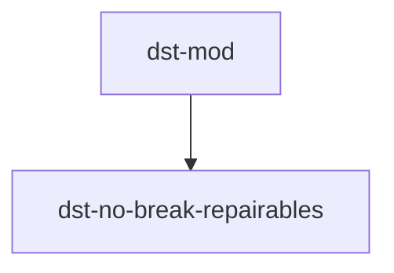

# DST Mods

> 饥荒联机版（Don't Starve Together）Mod 仓库，每个 Mod 使用独立子目录。

## Mod 列表

- [Repairable Gear Stays](dst-no-break-repairables/README.md)：可修复装备耐久归零后保留并失效，修复后恢复使用。

安装时将对应 Mod 子目录复制或软链接到游戏的 `mods` 目录。具体安装方法、兼容性和测试说明见各 Mod 的 README。
