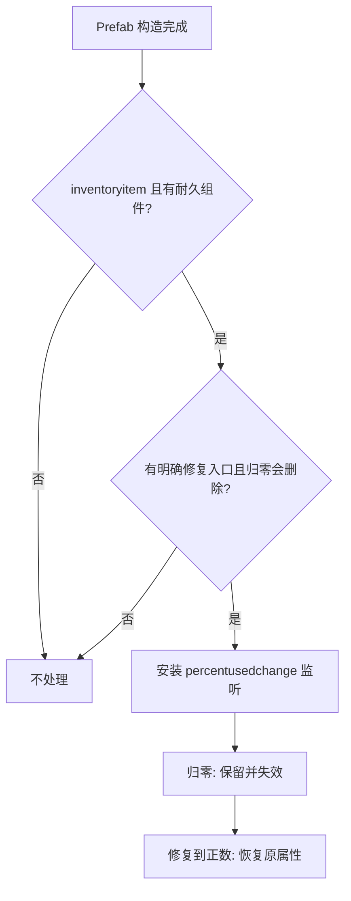

# DST 可修复耐久物品不消失 Mod 调研

> 结论：DST 没有统一的“耐久归零删除”入口；应在 prefab 初始化完成后，按 `armor`、`finiteuses`、`fueled` 的真实删除路径做小范围适配，并把 0 耐久语义定义为“实体保留、效果失效、修复后恢复”。

## 总览索引

- [源码与版本基线](#源码与版本基线)
- [三类耐久组件](#三类耐久组件)
- [指定物品](#指定物品)
- [实现方案](#实现方案)
- [覆盖边界](#覆盖边界)
- [验证结果](#验证结果)

## 源码与版本基线

本次调研以本机 Steam 安装包为主要证据：

- Steam AppID：`322330`
- Steam manifest buildid：`24080983`
- Dedicated Server 日志游戏版本：`706363`
- 源码包：`dontstarve_steam.app/Contents/data/databundles/scripts.zip`

公开 GitHub 仓库仅用于提供可点击的代码位置；实现判断均已与本机 `scripts.zip` 中的同名文件逐项核对。

Mod 的最小可加载结构是 `modinfo.lua + modmain.lua`。`AddPrefabPostInitAny` 在 prefab 自身构造和指定 prefab post-init 之后执行，能够读取最终安装的耐久组件与耗尽回调；`AddComponentPostInit` 太早，可能被 prefab 后续的 `SetOnFinished` 或 `SetDepletedFn` 覆盖。

## 三类耐久组件

| 组件 | 归零时的真实行为 | 原版修复入口 | Mod 接入点 |
|---|---|---|---|
| `armor` | `SetCondition` 先发 `percentusedchange`，再执行 `onfinished`；`keeponfinished` 非 true 时由组件调用 `inst:Remove()` | 由 prefab 自定义，组件仅提供 `Repair` | `SetKeepOnFinished(true)` |
| `finiteuses` | 首次从正数降到 0 时执行 `onfinished`；组件本身不删除 | `repairable` 可调用 `finiteuses:Repair` | 仅替换确认等于 `inst.Remove` 的 `onfinished` |
| `fueled` | fuel section 进入 0 时执行 `depleted`；组件本身不删除 | `accepting` 接收燃料；`FUELTYPE.USAGE` 可由 sewing 调用 `DoDelta` | 仅替换确认会删除的 `depleted` |



关键陷阱是 [`Armor:GetAbsorption`](https://github.com/CN-DST-DEVELOPER/scripts/blob/cfb77bf07e6496e344ac92652a08566d12067e8a/components/armor.lua#L126-L128) 不检查当前 condition。只调用 `SetKeepOnFinished(true)` 会让 0 耐久护甲继续减伤。因此普通破损装备必须自动卸下、禁止重新装备，并把吸收率设为 0。

## 指定物品

| 用户称呼 | prefab | 耐久路径 | 修复方式 | 破损处理 |
|---|---|---|---|---|
| 魔光护符 | `yellowamulet` | `fueled`，原 depleted 为 `inst.Remove` | 噩梦燃料、纯粹恐惧 | 自动卸下，清理光/移速效果并禁装 |
| 恐怖盾牌 | `shieldofterror` | `armor` 默认删除 | 喂食，修复量为 `abs(health) * 4 + abs(hunger) * 1.75` | 自动卸下、禁装、吸收率归零 |
| “恐怖头盔” | `eyemaskhat`，官中“眼面具” | `armor` 默认删除 | 与恐怖盾牌相同 | 自动卸下、禁装、吸收率归零 |

“恐怖头盔”不是当前官中物品名。它与恐怖盾牌并列出现时最可能指 Terraria 联动的眼面具，因此 Mod 明确覆盖 `eyemaskhat`。同时也覆盖可能被混称的 `dreadstonehat`（官中“绝望石头盔”）。

绝望石头盔和盔甲是特殊情况：原版在装备且角色处于普通理智模式（非启蒙模式）时自修复，并不要求进入低理智的疯狂状态。若归零时强制卸下并禁装，自修复永远不会启动；若只把 armor absorption 设为 0，planar defense、shadow damage resist、头盔防水和 set bonus 等装备效果仍可能生效。最终适配为归零时完整卸下并禁装，由 Mod 在物品持有者处于普通理智模式时按原版基础速率桥接第一次修复；耐久恢复为正数后取消桥接并恢复装备权限。

## 实现方案

实现复用原版 [`MakeForgeRepairable`](https://github.com/CN-DST-DEVELOPER/scripts/blob/cfb77bf07e6496e344ac92652a08566d12067e8a/standardcomponents.lua#L1779-L1812) 的核心模式：

1. 仅在 master simulation 修改组件。
2. 只接管有明确修复路径且确认归零会删除的 inventory item。
3. 归零时保存原 `restrictedtag` 和护甲吸收率。
4. 普通装备用 `Inventory:Unequip(..., force=true)` 触发原 `onunequip` 清理效果，再放回背包；背包无空间时沿用原版 `GiveItem` 的掉落行为。雨伞类在放回破损物品前保留原版 `umbrellaranout` 事件，并在旧 broken 同类物品截断原版单次查找时显式选择健康备用品。
5. 设置 Mod 专属 equip restriction，并将 armor absorption 设为 0。
6. 监听 `percentusedchange`；耐久大于 0 时恢复原 restriction 和 absorption。
7. 绝望石装备归零后启动单独的周期任务；持有者处于普通理智模式时按原版基础公式修复一次，随后恢复装备权限；玩家重新穿戴后由原版继续自修复。
8. 延后一帧同步一次状态，覆盖 `Fueled:OnLoad` 只初始化数值、不发送 `percentusedchange` 的存档加载路径。

没有整体重写 `Armor:SetCondition`、`FiniteUses:SetUses`、`Fueled:DoDelta` 或 `EntityScript.Remove`，避免破坏其他 Mod 和游戏更新增加的组件语义。

## 覆盖边界

通用识别条件：

- `finiteuses + repairable + repairmaterial + equippable`，且 `onfinished == inst.Remove`。
- `fueled + equippable`，fuel type 或 secondary fuel type 为 `FUELTYPE.USAGE`，且 `no_sewing ~= true`。
- `fueled + equippable + accepting == true`，且确认 depleted 会删除。
- 自定义删除回调只为已核实的原版 prefab 建 allowlist；伯尼另行取消原版破损落地后的延迟分解任务。
- `shieldofterror`、`eyemaskhat`、`dreadstonehat`、`armordreadstone` 使用 armor allowlist。

明确排除：

- `forgerepairable`：原版已有完整 broken/repaired 状态。
- `perishable`、建筑 `health/workable`：这不是本需求中的装备耐久。
- 非装备型 fueled 物品，例如暖石。
- `no_sewing = true` 或没有其他修复入口的耗损装备。
- 第三方 prefab 的未知自定义耗尽回调；自动执行或吞掉这些回调都可能丢失特殊副作用。

停用限制：Mod 自己的 broken tag 不写入独立存档字段，而是从耐久值重建。启用 Mod 时重载安全；如果在物品仍为 0 时停用 Mod，原版可能在下次加载删除 armor 物品，或允许 fueled 物品短暂错误生效。停用前应先修复所有破损物品。

装备限制边界：`equippable.restrictedtag` 是原版玩家装备路径的机制；NPC 或第三方实体若绕过玩家 `Inventory:Equip`，不保证自动拦截 0 耐久装备。

## 验证结果

在本机真实 `dontstarve_dedicated_server_nullrenderer` 上创建 offline small 世界并启用本地 Mod，结果：

```text
Loading mod: dst-no-break-repairables (Repairable Gear Stays) Version:1.0.0
LOADING LUA SUCCESS
[NBR TEST] RESULT: passed=65 failed=0
```

运行测试覆盖：

- 魔光护符归零、自动卸下、禁装、实际添加噩梦燃料和恢复。
- 恐怖盾牌与眼面具从装备态归零、强制卸下、实际禁装、0 吸收、实际吃浆果和恢复。
- 橙色护符从装备态归零、强制卸下、实际禁装、用噩梦燃料走 `repairable` 修复和恢复。
- `raincoat` 直接删除回调、`umbrella` 自定义删除回调、真实 sewing kit 修复，以及雨伞耗尽时自动装备备用雨具。
- 背包中已有同类 broken 盾牌或雨伞时，后续健康备用品仍能自动装备。
- `bernie_inactive` 破损落地后的延迟删除路径和真实 sewing kit 修复。
- 绝望石头盔和盔甲归零后卸下/禁装、零理智、普通理智模式下的破损自修复桥接，以及恢复后周期任务退出。
- `greenamulet`、`walking_stick`、`footballhat` 三类不可修复反例维持原版删除。

## 参考资料

- [Klei Modding Practices: Introduction to Modding](https://forums.kleientertainment.com/forums/topic/50773-guide-modding-practices-introduction-to-modding/)
- [Klei 论坛：AddComponentPostInit 的执行时机](https://forums.kleientertainment.com/forums/topic/130808-how-does-addcomponentpostinit-exactly-works/)
- [Klei 论坛：Custom helmet repair 讨论](https://forums.kleientertainment.com/forums/topic/165213-help-for-a-custom-helmet-mod/)
- [finiteuses 源码镜像](https://github.com/CN-DST-DEVELOPER/scripts/blob/cfb77bf07e6496e344ac92652a08566d12067e8a/components/finiteuses.lua#L64-L130)
- [armor 源码镜像](https://github.com/CN-DST-DEVELOPER/scripts/blob/cfb77bf07e6496e344ac92652a08566d12067e8a/components/armor.lua#L31-L170)
- [fueled 源码镜像](https://github.com/CN-DST-DEVELOPER/scripts/blob/cfb77bf07e6496e344ac92652a08566d12067e8a/components/fueled.lua#L149-L323)
- [repairable 源码镜像](https://github.com/CN-DST-DEVELOPER/scripts/blob/cfb77bf07e6496e344ac92652a08566d12067e8a/components/repairable.lua#L92-L183)
- [魔光护符源码镜像](https://github.com/CN-DST-DEVELOPER/scripts/blob/cfb77bf07e6496e344ac92652a08566d12067e8a/prefabs/amulet.lua#L570-L597)
- [恐怖盾牌源码镜像](https://github.com/CN-DST-DEVELOPER/scripts/blob/cfb77bf07e6496e344ac92652a08566d12067e8a/prefabs/shieldofterror.lua#L39-L107)
- [眼面具源码镜像](https://github.com/CN-DST-DEVELOPER/scripts/blob/cfb77bf07e6496e344ac92652a08566d12067e8a/prefabs/hats.lua#L2312-L2364)
